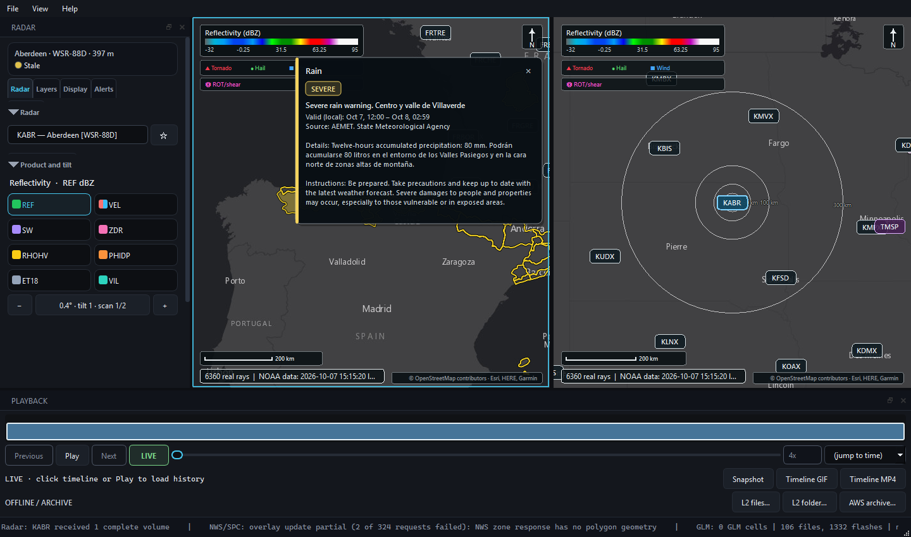

# CappedWeather

Live WSR-88D / TDWR Level II radar viewer in Qt6/C++. It also handles European OPERA volumes, GOES lightning fusion, and severe-weather analysis. No synthetic frames: nothing renders until real data decodes.

## Screenshots

### Quad-panel console view


### Pinned warning card



## Download

Grab the latest build from the [Releases page](https://github.com/Mikifrfr/CappedWeather/releases):

- **Windows**: `CappedWeather-*-Windows-*.exe` is a one-click NSIS installer (Start-menu shortcut, bundled Qt + BZip2 + netCDF + HDF5). Prefer portable? `CappedWeather-*-Windows-*.zip`: unzip and run `CappedWeather.exe`, no install needed.
- **Linux**: `CappedWeather-v*-Linux-x86_64.tgz`: extract and run `./AppDir/AppRun` (built on Ubuntu 22.04, runs on newer distros too).

Release assets are built from tags (`v*`) by `.github/workflows/release.yml` with full Qt + netCDF + HDF5 on both OS. Sources for any binary are the matching tag (AGPL-3.0-or-later, see `LICENSE`).

## Quick start

1. Pick a station: search, favorite, or chase mode.
2. Hit **LIVE**: chunks stream in progressively and the newest frame follows.
3. Scrub the filmstrip, toggle overlays, press `?` for shortcuts.

## Features

### Radar & products

- Six native Level II moments (REF, VEL, SW, ZDR, RHOHV, PHIDP) plus derived 18 dBZ Echo Tops, VIL, composite reflectivity, and CAPPI from real multi-tilt volumes ([formulas & limits](docs/derived-products.md)). Products live in the left-dock grid (keys 1-9, 0); picking CAPPI reveals its altitude box (2-7 km MSL) underneath.
- 1×1, 1×2, 2×1, 2×2 layouts; every panel owns its radar, product, tilt, and velocity mode.
- Native, dealiased, and storm-relative velocity; TDWR and single-pol OPERA sites auto-disable missing dual-pol products.
- Operational, Capped, and color-safe palettes plus importable `native_value,#RRGGBB` custom palettes.

### Overlays & alerts

- NWS warnings (polygons with holes, zone-only alerts resolved to official geometry), Environment Canada alerts (open MSC GeoMet feed, same rows and colors), and rolling 24-hour SPC tornado/hail/wind reports.
- SPC Day 1 + 2 categorical outlooks in official colors and active mesoscale discussions with watch probability; tornado and severe watches arrive through NWS alerts.
- SPC Day 1 + 2 fire-weather outlooks (DryT + WindRH) and NHC active tropical cyclones (forecast cone plus track line; hurricane watches/warnings arrive through NWS alerts).
- WPC Day 1-3 excessive rainfall outlooks in official colors (Marginal green, Slight yellow, Moderate red, High pink).
- NOAA HMS daily fire detections plus smoke plumes in official density colors, with today-then-yesterday fallback.
- GOES GLM lightning-jump cells (2σ LJA) fused with reflectivity objects ([engine](docs/lightning-jump-engine.md)); honestly disabled without netCDF, live out of the box in releases.
- Meteoalarm warnings for European sites; 130+ bucket-active OPERA radars as first-class sessions (CC BY 4.0 EUMETNET, [sources](docs/europe-sources.md)).
- METAR surface stations near the selected radar (temp/dew markers colored by flight category, wind and age on click).
- Alert center with sound + tray notification, severity/geo/suppression filters, and a severity-sorted warning inbox.

### Analysis

- TVS / mesocyclone markers (NSSL-style couplet heuristic), rotation/shear overlay, VIL-density hail cores with guidance size ranges, and polarimetric debris confirmation at live couplets. Per-storm tracks with +10/+20/+30 min extrapolation. Guidance only, never warnings ([rotation validation](docs/rotation-validation.md), [hail/TDS validation](docs/severe-hail-tds-validation.md)).
- Measure (great-circle range/bearing), beam height, scan diagnostics with per-tilt table and VAD wind profile ([derived products](docs/derived-products.md)), and modeless multi-tilt cross-sections with CSV export.
- Scoped Archive-II case loading (local files or an AWS time window), shareable case-pack export/import, and a GR-compatible placefile subset ([limits](docs/placefiles-and-archives.md)).

### Playback & export

- Live-follow, looping, 0.5×–16× speeds, filmstrip with warning ticks and bookmarks, jump to earliest/latest or an absolute time.
- PNG snapshots, frame-exact timeline GIFs, MP4 capture, frame-exact WebM through ffmpeg when installed, KML frame export for GIS, offline map packs for no-signal chasing, and spill-to-disk history beyond the RAM window.

### Interface

- Tabbed sidebar, `Ctrl+K` command palette, nav history (`Ctrl+Z`), named layout presets, per-panel overlay toggles with opacity and z-order.
- Chase mode with IP-based position detect, offline banner, and a low-bandwidth data-saver preset.
- Classic and Squall dark themes, interface text scale, full keyboard map (`?`/`F1`).

## Build

Core library and tests need only a C++20 compiler and CMake:

```powershell
cmake -S . -B build
cmake --build build --config Release
ctest --test-dir build -C Release --output-on-failure
```

The desktop app additionally needs:

| | Windows | Linux (Ubuntu 22.04) |
|---|---|---|
| Qt | 6.8 via `aqt` (`CMAKE_PREFIX_PATH=C:/Qt/6.8.3/msvc2022_64`) | 6.8 via `aqt` |
| Codecs | BZip2 (zlib optional) | `libbz2-dev` (`zlib1g-dev` optional) |
| Live lightning | `netcdf-c` via vcpkg | `libnetcdf-dev` |
| European volumes | `hdf5` via vcpkg | `libhdf5-dev` |

Production builds fail fast without netCDF/HDF5 (`CAPPEDWEATHER_REQUIRE_NETCDF/HDF5=ON`); stub-only dev builds opt out with `=OFF`. See `.github/workflows/release.yml` for the exact release recipe. Live-network smoke tests in `tests/` hit only real public NOAA/NWS endpoints.

## Data sources

- Real-time Level II chunks: `https://unidata-nexrad-level2-chunks.s3.amazonaws.com/`
- Historical Archive-II volumes: `https://unidata-nexrad-level2.s3.amazonaws.com/`
- European OPERA volumes (anonymous): `https://s3.waw3-1.cloudferro.com/openradar-24h` (CC BY 4.0 EUMETNET; see `docs/europe-sources.md`)
- Station catalog, warnings, reports: `https://api.weather.gov/radar/stations`, `https://api.weather.gov/alerts/active`, `https://www.spc.noaa.gov/climo/reports/`

Plain HTTPS listing and download requests, no cloud SDK. The embedded station fallback contains only real station classes. No generated stations, no synthetic frames.

## License

Copyright (C) 2026 Mikifrfr

This program is free software: you can redistribute it and/or modify
it under the terms of the GNU Affero General Public License as published by
the Free Software Foundation, either version 3 of the License, or
(at your option) any later version. See `LICENSE` for the full text.

Source for release binaries is available at <https://github.com/Mikifrfr/CappedWeather>.

European OPERA data is CC BY 4.0 EUMETNET (see `docs/europe-sources.md`).
Basemap (c) OpenStreetMap contributors and CARTO/Esri, with attribution painted on-canvas. Paste a free CARTO key (Settings: Basemap) to switch from Esri to CARTO tiles; the key is kept in your user settings across updates. The Custom slot takes any XYZ template, with one-click presets for the IEM US NEXRAD mosaic and the RainViewer global mosaic (covers Canadian ECCC radars, no key needed).
