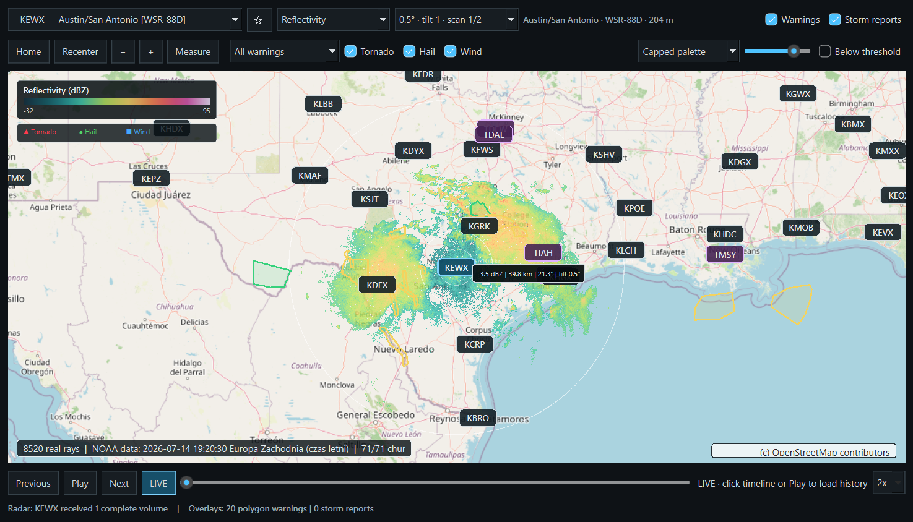
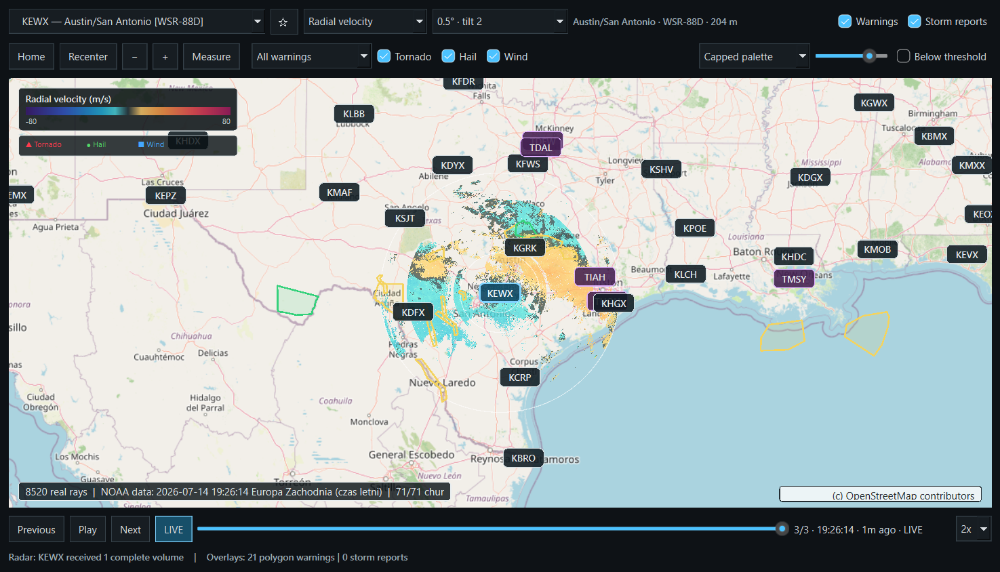

# CappedWeather

CappedWeather is a small Qt6/C++ WSR-88D and TDWR Level II viewer focused on direct operational data.

The application does not ship synthetic or demo radar frames. It discovers live Level II objects from NOAA's public AWS buckets and displays an explicit unavailable/stale state when data cannot be obtained.

## Screenshots

### Live reflectivity



### Radial velocity



## Build

The core library and tests require only a C++20 compiler and CMake:

```powershell
cmake -S . -B build -G "Visual Studio 17 2022" -A x64
cmake --build build --config Release
ctest --test-dir build -C Release --output-on-failure
cpack --config build/CPackConfig.cmake -C Release
```

The optional live-data smoke test uses only real public NOAA/NWS responses:

```powershell
powershell -NoProfile -ExecutionPolicy Bypass -File .\tests\live_data_smoke.ps1 -RadarId KTLX
powershell -NoProfile -ExecutionPolicy Bypass -File .\tests\live_data_smoke.ps1 -RadarId TATL
powershell -NoProfile -ExecutionPolicy Bypass -File .\tests\live_overlays_smoke.ps1
```

When Qt6 and BZip2 are available, CMake also builds the `CappedWeather` desktop target. Set `CMAKE_PREFIX_PATH` to the Qt installation if it is not discoverable:

```powershell
cmake -S . -B build -DCMAKE_PREFIX_PATH="C:/Qt/6.8.0/msvc2022_64"
```

The GUI target additionally needs BZip2. On Windows, pass the include directory and static library explicitly if CMake cannot discover it:

```powershell
cmake -S . -B build `
  -DCMAKE_PREFIX_PATH="C:/Qt/6.8.0/msvc2022_64" `
  -DBZIP2_INCLUDE_DIR="C:/path/to/bzip2" `
  -DBZIP2_LIBRARY_RELEASE="C:/path/to/libbz2.lib"
```

## Data sources

- Real-time Level II chunks: `https://unidata-nexrad-level2-chunks.s3.amazonaws.com/`
- Live official station catalog: `https://api.weather.gov/radar/stations`
- Active warning GeoJSON and zone geometry: `https://api.weather.gov/alerts/active`
- Preliminary storm reports: `https://www.spc.noaa.gov/climo/reports/`
- Official NEXRAD data documentation: <https://www.ncei.noaa.gov/products/radar/next-generation-weather-radar>

The application uses public HTTPS listing and download requests, with no cloud SDK. The official NWS station catalog is filtered to `WSR-88D` and `TDWR` stations; the embedded fallback contains the same real station classes and no generated stations.

The viewer exposes the decoded product fields and the elevation tilts present in the received volume. It does not render an echo until a real Level II chunk has been downloaded and decoded.

## Current viewer features

- Six native Level II products with product-specific color scales and units.
- Switchable 1x1, 1x2, 2x1, and 2x2 radar layouts. Every panel can use its own radar, product, tilt, and velocity mode; map navigation can remain linked.
- Discrete native operational palettes for all six products, with improved legend labels.
- Importable, persistent custom palettes using `native_value,#RRGGBB` lines, plus Capped and color-safe presets.
- TDWR volumes expose their available base moments (reflectivity, radial velocity, and spectrum width); unavailable dual-polarization products are disabled automatically.
- Searchable radar selection with persistent favorites, recent sites, optional manual-position chase mode, zoom-aware station decluttering, station details, and national/recenter controls.
- Cursor sampling for value, range, azimuth, and elevation tilt, including below-threshold and range-folded gates.
- Up to eight recent NOAA volumes per radar session in memory, with explicit live-follow mode, timestamped frame stepping, looping playback, 1x/2x/4x speeds, and repeated supplemental tilts retained separately.
- Non-blocking chunk progress, retry/cancel controls, per-chunk automatic retries, partial-volume recovery, and visible completeness metadata.
- Bounded parallel chunk downloads, transfer timeouts, retry backoff, last-known-good overlay retention, and bounded memory/disk map caches.
- Active NWS warnings, including zone-only alerts resolved to official zone geometry and polygons with holes. Details include onset, expiry, sender, description, and instructions.
- Rolling 24-hour SPC tornado, hail, and wind reports with 12Z convective-day handling, absolute UTC time, age, filters, a symbol legend, and interactive details.
- Native, dealiased, and storm-relative velocity with configurable Nyquist velocity and storm motion.
- Great-circle range/bearing tools, standard-atmosphere beam height, scan coverage/gap diagnostics, and multi-tilt vertical cross-sections.
- PNG snapshots, animated GIF timelines, and cross-section CSV export.
- Cached, color-batched radar geometry built off the UI thread; decoded frames are shared across panels instead of copied.
- Parser rejection diagnostics and randomized malformed-input tests for Message 31 framing and moment bounds.
- Persistent operational settings for panels, products, palettes, overlays, opacity, playback, timeline depth, and window geometry.

## Operator notes

- `Measure` reports great-circle distance and bearing. `Cross-section` uses the same two-point gesture and opens a distance/height view across all available tilts.
- The velocity controls apply to the active panel. Storm direction is the direction toward which the storm moves; speed and Nyquist are in m/s.
- Custom palettes are discrete native-value thresholds. Example: `20,#02fd02` followed by `30,#008e00`.
- `Timeline GIF` exports every currently loaded frame for the active radar. It intentionally does not retrieve an archive; load depth is controlled in Settings.
- Network Settings provide request concurrency, retries, timeouts, cache limits, contact information, chase position, history depth, and panel-navigation linking.
