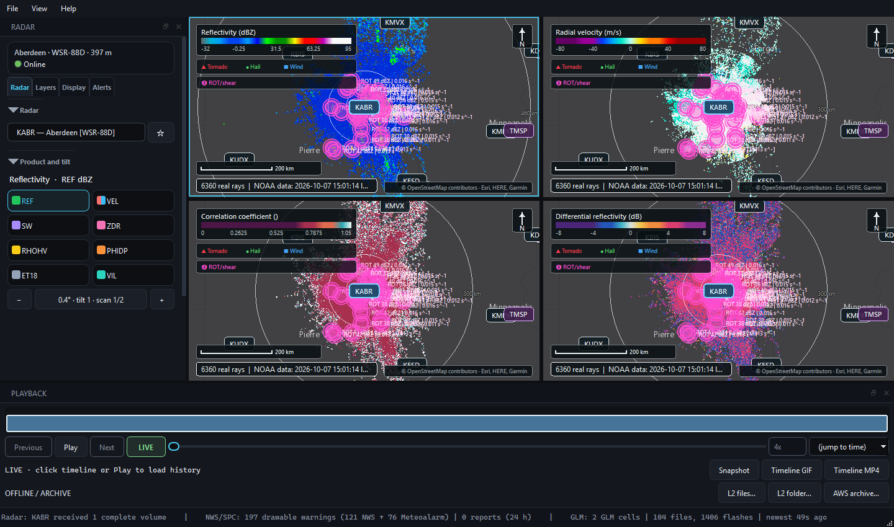
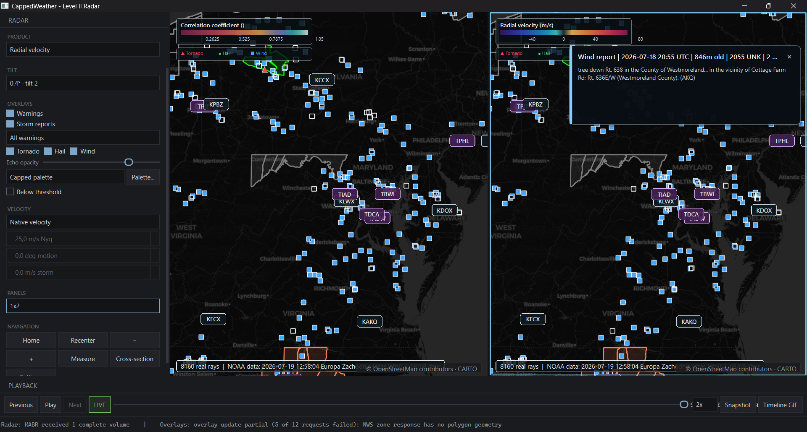

# CappedWeather

CappedWeather is a small Qt6/C++ WSR-88D and TDWR Level II viewer focused on direct operational data.

## Download

Grab the latest portable build from the [Releases page](https://github.com/Mikifrfr/CappedWeather/releases):

- **Windows**: `CappedWeather-*-Windows-*.zip` — unzip and run `CappedWeather.exe`, no install needed.
- **Linux**: `CappedWeather-v*-Linux-x86_64.tgz` — extract and run `./AppDir/AppRun` (built on Ubuntu 22.04, runs on newer distros too).

Release builds stub the GLM lightning reader (no netCDF); everything else is live.

## Screenshots

### Quad-panel console view



### SPC storm reports



## Build

The core library and tests require only a C++20 compiler and CMake:

```powershell
cmake -S . -B build -G "Visual Studio 17 2022" -A x64
cmake --build build --config Release
ctest --test-dir build -C Release --output-on-failure
cpack --config build/CPackConfig.cmake -C Release
```

The optional live-data smoke test uses only real public NOAA/NWS responses:

```powershell
powershell -NoProfile -ExecutionPolicy Bypass -File .\tests\live_data_smoke.ps1 -RadarId KTLX
powershell -NoProfile -ExecutionPolicy Bypass -File .\tests\live_data_smoke.ps1 -RadarId TATL
powershell -NoProfile -ExecutionPolicy Bypass -File .\tests\live_overlays_smoke.ps1
```

When Qt6 and BZip2 are available, CMake also builds the `CappedWeather` desktop target. Set `CMAKE_PREFIX_PATH` to the Qt installation if it is not discoverable:

```powershell
cmake -S . -B build -DCMAKE_PREFIX_PATH="C:/Qt/6.8.0/msvc2022_64"
```

The GUI target additionally needs BZip2. On Windows, pass the include directory and static library explicitly if CMake cannot discover it:

```powershell
cmake -S . -B build `
  -DCMAKE_PREFIX_PATH="C:/Qt/6.8.0/msvc2022_64" `
  -DBZIP2_INCLUDE_DIR="C:/path/to/bzip2" `
  -DBZIP2_LIBRARY_RELEASE="C:/path/to/libbz2.lib"
```

Live GLM ingestion requires netCDF-C. The build **defaults to
`CAPPEDWEATHER_REQUIRE_NETCDF=ON`** so production builds fail-fast when
netCDF is unavailable instead of silently shipping the stub reader.

Provide the netCDF CMake config directory and build as usual:

```powershell
cmake -S . -B build `
  -DnetCDF_DIR="C:/path/to/netcdf/lib/cmake/netCDF"
cmake --build build --config Release --target cappedweather_live_glm_probe
.\build\Release\cappedweather_live_glm_probe.exe
```

To develop without netCDF (stub-only build), disable the requirement
with a CMake variable or environment variable:

```powershell
# Either pass -D on the command line:
cmake -S . -B build -DCAPPEDWEATHER_REQUIRE_NETCDF=OFF

# Or export the env var (works with any CMake invocation):
$env:CAPPEDWEATHER_REQUIRE_NETCDF = "OFF"
cmake -S . -B build
```

## Data sources

- Real-time Level II chunks: `https://unidata-nexrad-level2-chunks.s3.amazonaws.com/`
- Historical Archive-II volumes: `https://unidata-nexrad-level2.s3.amazonaws.com/`
- European OPERA volumes (anonymous): `https://s3.waw3-1.cloudferro.com/openradar-24h` (CC BY 4.0 EUMETNET; see `docs/europe-sources.md`)
- Live official station catalog: `https://api.weather.gov/radar/stations`
- Active warning GeoJSON and zone geometry: `https://api.weather.gov/alerts/active`
- Preliminary storm reports: `https://www.spc.noaa.gov/climo/reports/`
- Official NEXRAD data documentation: <https://www.ncei.noaa.gov/products/radar/next-generation-weather-radar>

The application uses public HTTPS listing and download requests, with no cloud SDK. The official NWS station catalog is filtered to `WSR-88D` and `TDWR` stations; the embedded fallback contains the same real station classes and no generated stations. European OPERA sites (179 operational radars) come from EUMETNET's station list and stream ODIM_H5 volumes over anonymous S3.

The viewer exposes the decoded native moment fields and elevation tilts present in the received volume, then derives Echo Tops and VIL only from assembled real reflectivity volumes. It does not render an echo until real Level II data has been downloaded and decoded.

## Current viewer features

- Six native Level II moments plus two volume-derived 2D products: 18 dBZ Echo Tops (kft MSL) and VIL (kg/m²), each with product-specific scales, palettes, probing, panel persistence, and timeline rendering. See `docs/derived-products.md` for formulas and quality limits.
- Switchable 1x1, 1x2, 2x1, and 2x2 radar layouts. Every panel can use its own radar, product, tilt, and velocity mode; map navigation can remain linked.
- Product chips carry the standard operational abbreviation (REF, VEL, SW, ZDR, RHOHV, PHIDP, ET18, VIL) so the whole set fits a narrow dock; the active product is spelled out in full directly above the grid and in each chip's tooltip.
- Discrete native operational palettes for all six products, with improved legend labels.
- Importable, persistent custom palettes using `native_value,#RRGGBB` lines, plus Capped and color-safe presets.
- TDWR volumes expose their available base moments (reflectivity, radial velocity, and spectrum width); unavailable dual-polarization products are disabled automatically.
- Searchable radar selection with persistent favorites, recent sites, optional manual-position chase mode, zoom-aware station decluttering, station details, and national/recenter controls.
- 132 bucket-active EUMETNET OPERA radars (ODIM volumes over anonymous S3, CC BY 4.0) alongside NEXRAD: same panels, tilts, products, timeline, and export. Networks that stopped sharing (ES/UK/HU/SK/GR/PT/RS/IL/LV/MD) are excluded; Lithuania/Iceland additions included. Dual-pol products unlock automatically once OPERA serves them.
- Cursor sampling for value, range, azimuth, and elevation tilt, including below-threshold and range-folded gates.
- Up to eight recent NOAA volumes per radar session in memory, with explicit live-follow mode, timestamped frame stepping, looping playback, 1x/2x/4x speeds, and repeated supplemental tilts retained separately.
- Scoped Archive-II case-study loading from local files/folders or a selected radar/time window in the public AWS archive. Bzip records decode off the UI thread and join the normal timeline/product pipeline.
- GR-compatible placefile file/URL loading with automatic refresh, labels, chaser/spotter markers, lines, polygons, threshold-aware rendering, and interactive hover details. See `docs/placefiles-and-archives.md` for the supported subset and honest limits.
- Non-blocking chunk progress, retry/cancel controls, per-chunk automatic retries, partial-volume recovery, and visible completeness metadata.
- Bounded parallel chunk downloads, transfer timeouts, retry backoff, last-known-good overlay retention, and bounded memory/disk map caches.
- Active NWS warnings, including zone-only alerts resolved to official zone geometry and polygons with holes. Details include onset, expiry, sender, description, and instructions.
- Rolling 24-hour SPC tornado, hail, and wind reports with 12Z convective-day handling, absolute UTC time, age, filters, a symbol legend, and interactive details.
- Native, dealiased, and storm-relative velocity with configurable Nyquist velocity and storm motion.
- Great-circle range/bearing tools, standard-atmosphere beam height, scan coverage/gap diagnostics, and multi-tilt vertical cross-sections.
- PNG snapshots, animated GIF timelines, and cross-section CSV export.
- Cached, color-batched radar geometry built off the UI thread; decoded frames are shared across panels instead of copied.
- Dock-based console layout with movable control and playback docks, a flat dark theme, and a dark Esri World Dark Gray basemap (base + reference labels, no API key).
- Tabbed sidebar (Radar / Layers / Display / Alerts) with a pinned station card, so the dock stops scrolling on laptop windows.
- Warning inbox on the Alerts tab: every active warning sorted by severity then newest — click to fly the panel there and pin the card, hover to outline the polygon.
- Filmstrip timeline under the transport buttons: one block per loaded volume, red ticks for warning onsets, amber caps for bookmarks (`B` or right-click).
- Linked cursor probe: hovering one panel shows a ghost readout with the same gate sampled in every other visible panel (each in its own product).
- `Ctrl+K` command palette over radars, products, layouts, and actions.
- Storm-track extrapolation (+10/+20/+30 min dead reckoning), double-click a pinned card to expand it, dark-halo warning outlines that survive bright echo.- Parser rejection diagnostics and randomized malformed-input tests for Message 31 framing and moment bounds.
- Persistent operational settings for panels, products, palettes, overlays, opacity, playback, timeline depth, and window geometry.

## Performance

- Gate geometry is color-batched and rasterized into a cached overlay image off the UI thread; pan and zoom re-blit the cache instead of re-walking rays.
- One decoded volume feeds every panel — the 2x2 layout renders four products from a single decode, not four.
- Cached overlay images survive zoom transitions: they are rescaled on screen and reused until the background rebuild lands, so zooming stays fluid instead of hitching on a re-render.
- Warnings and storm reports publish progressively — polygons appear as soon as their own responses land rather than after the slowest request, and failed requests keep the last known good overlay instead of blanking the map.
- Chunk downloads are bounded-parallel with per-chunk retries, timeouts, and backoff; basemap tiles use bounded memory and disk caches shared across panels.
- Level II chunks stream in progressively: the map starts painting at 500 rays and fills in every 4000 more, while Echo Tops/VIL derive in the background and swap in when ready.
- Downloaded chunks persist in a 512 MB on-disk cache per source, so revisiting a radar (or restarting) skips bytes instead of re-downloading; listings always bypass the cache so the newest scan is never hidden.
- A full volume is on the order of 8,000+ rays across ~70 chunks, and up to eight volumes per radar are held in memory for instant timeline scrubbing.

## Operator notes

- `Measure` reports great-circle distance and bearing. `Cross-section` uses the same two-point gesture and opens a distance/height view across all available tilts. Middle-drag pans; hover a station for a pointer cursor; right-click for a menu that also offers *Close card* and *Cancel tool*.
- High-resolution wheels and precision trackpads zoom normally (fractional wheel deltas are normalized, with a `pixelDelta` fallback).
- The velocity controls apply to the active panel. Storm direction is the direction toward which the storm moves; speed and Nyquist are in m/s.
- Custom palettes are discrete native-value thresholds. Example: `20,#02fd02` followed by `30,#008e00`.
- `Timeline GIF` exports every currently loaded frame for the active radar. Use the playback dock's `L2 files`, `L2 folder`, or `AWS archive` actions first when exporting a historical case.
- Network Settings provide request concurrency, retries, timeouts, cache limits, contact information, chase position, history depth, and panel-navigation linking.

## Accessibility

- Every control has a visible keyboard focus indicator in both themes. Qt stops drawing its default focus ring as soon as a stylesheet sets a `border`, so focus is defined explicitly per theme.
- Secondary text (captions, group headers, layer sub-labels, the station-picker placeholder) clears 4.5:1 against the dock background, and disabled controls keep a visible border rather than fading to ~1.1:1.
- The status bar elides its three-part summary instead of hard-cutting, with the full text on hover; on-map HUD text carries a dark halo so labels stay legible over bright echo.
- Both themes style the same widget set, so switching themes never leaves a native-looking control in a themed dialog. The settings dialog scrolls, keeping OK/Cancel reachable at larger text sizes.
- Full card keyboard focus and a font-scale preference remain open items (see `TODO.md`).
